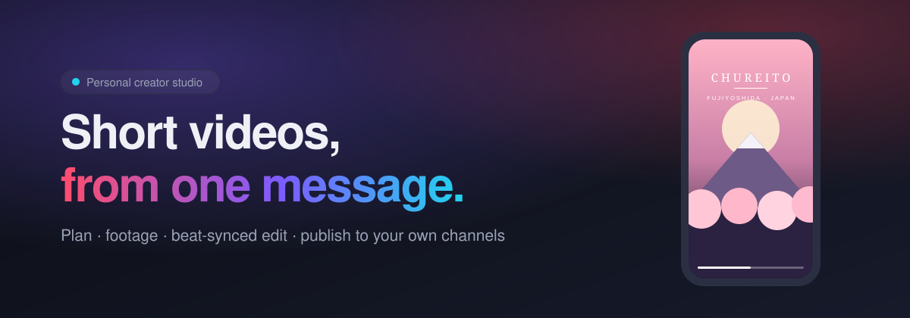

  

<h3 align="center">Describe the video. Get a ready-to-post vertical short.</h3>

  <a href="https://ugurturna.github.io/re_factory/"><b>🌐 Website</b></a> ·
  <a href="https://ugurturna.github.io/re_factory/privacy.html">Privacy Policy</a> ·
  <a href="https://ugurturna.github.io/re_factory/terms.html">Terms of Service</a>

---

## ✨ What it does

|  |  |
|---|---|
| 🧭 **Shot planning** | A short description becomes a shot list with on-screen titles, places and a matching style. |
| 🎥 **Real footage first** | High-quality real footage and photos are preferred and checked shot by shot; generated clips only fill the gaps. |
| 🎵 **Cuts on the beat** | A fitting track — or the one you name — with every cut lined up to the rhythm. |
| 🎞 **Copy a format** | Share a video you like and get the same pacing, transitions and text style with a brand-new theme. |
| 🖼 **Thumbnail & captions** | Cover, title, a description with location notes and the right hashtags for each platform. |
| ✏️ **Revise in plain words** | “Slower”, “swap shot 3”, “use this song” — applied and kept in the history. |

## 🚀 How it works

1. **Describe** — a theme, a list or a reference link, from your phone or the dashboard.
2. **Approve the plan** — review the proposed shots and sources before anything is made.
3. **Preview & revise** — watch the finished video and ask for changes in plain words.
4. **Publish** — send it to one or all of your connected channels with a single tap.

## 📲 Platforms

**YouTube Shorts** · **Instagram Reels** · **TikTok**

## 🔒 Privacy first

- Access tokens stay encrypted on the owner's own computer — nothing is sold or shared.
- Nothing is downloaded, generated or published without your approval.
- Revoke access anytime from your Google, Instagram or TikTok settings.

---

ShortyReelFactory is a personal tool and is not offered as a public service. © 2026

